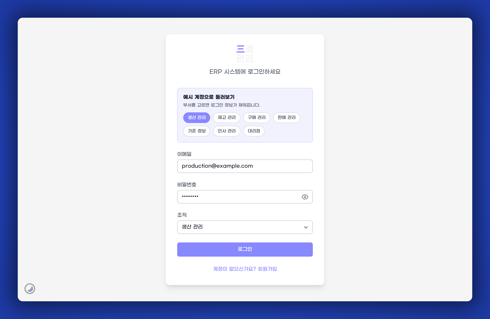
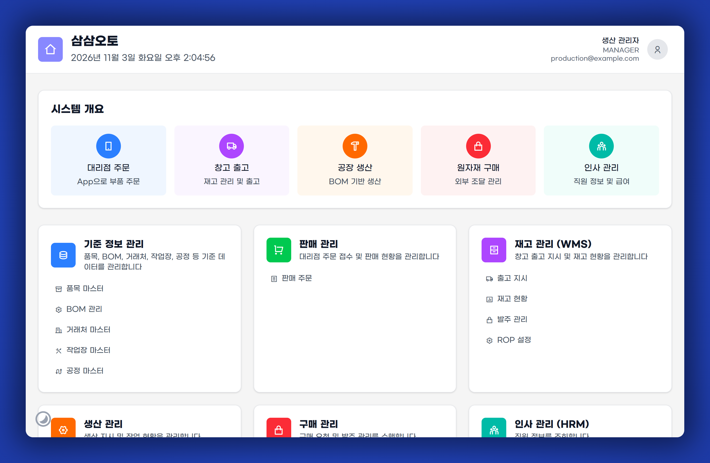
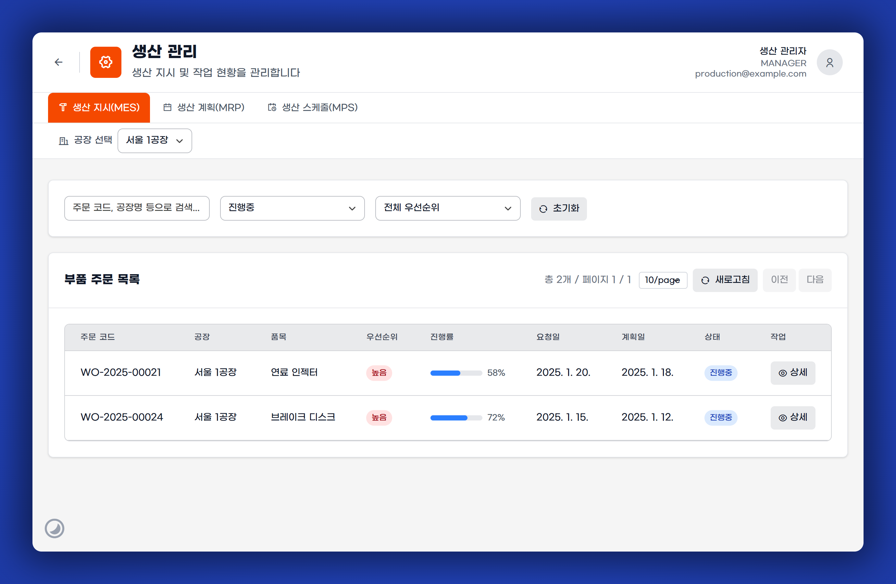
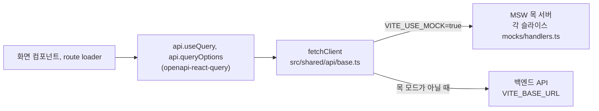

# 삼품관리 프론트엔드

자동차 부품 제조사의 생산, 재고, 구매, 판매, 기준 정보, 인사 업무를 한곳에서 다루는 ERP 웹 화면입니다.
현대오토에버 모빌리티 SW 스쿨 3조(33-Auto)가 만든 팀 프로젝트의 프론트엔드 저장소입니다.

**배포본: https://sampoom.vercel.app**

> 2026년 11월 현재 백엔드 서버는 내려가 있습니다. 배포본과 로컬 개발 서버는 모두 브라우저 안에서 도는 목 서버(MSW)로 동작하므로, 백엔드 없이 화면을 끝까지 눌러볼 수 있습니다. 새 기능도 목 서버에서 동작하면 됩니다.

## 1분 만에 써보기

1. https://sampoom.vercel.app 에 들어갑니다.
2. 로그인 화면의 "예시 계정으로 둘러보기"에서 부서를 하나 고릅니다. 이메일, 비밀번호, 조직이 채워집니다.
3. 로그인을 누르면 홈으로 이동합니다. 홈의 모듈 카드나 그 아래 메뉴를 눌러 각 화면으로 들어갑니다.

| 부서      | 이메일                 | 비밀번호 |
| --------- | ---------------------- | -------- |
| 생산 관리 | production@example.com | 12341234 |
| 재고 관리 | inventory@example.com  | 12341234 |
| 구매 관리 | purchase@example.com   | 12341234 |
| 판매 관리 | sales@example.com      | 12341234 |
| 기준 정보 | md@example.com         | 12341234 |
| 인사 관리 | hr@example.com         | 12341234 |
| 대리점    | agency@example.com     | 12341234 |

목 서버에는 계정이 20개 있습니다. 위 표는 로그인 화면 칩에 나오는 부서별 관리자 계정이고, 나머지는 `production2@example.com`, `production3@example.com` 같은 담당자 계정입니다. 비밀번호는 모두 `12341234`입니다. 전체 목록은 `src/entities/user/mocks/data.ts`에서 볼 수 있습니다.

써보기 전에 알아두면 좋은 점:

- **어느 계정으로 들어가도 같은 화면이 보입니다.** 목 서버는 이메일과 비밀번호만 확인하고 조직 값은 보지 않습니다. 부서나 직급에 따라 메뉴와 권한을 나누는 기능은 아직 없고, 직급은 오른쪽 위 사용자 정보에 표시만 됩니다.
- **새로고침하면 데이터가 처음 상태로 돌아갑니다.** 목 데이터는 브라우저 메모리에 있어서, 등록하거나 수정한 내용과 회원가입으로 만든 계정은 새로고침하면 사라집니다. 로그인 상태는 쿠키에 남아 유지됩니다.
- 회원가입한 계정은 승인 없이 바로 로그인할 수 있습니다. 이 계정도 새로고침하면 사라집니다.
- 다른 계정으로 바꾸려면 오른쪽 위 사용자 아이콘을 눌러 로그아웃한 뒤 다시 고르면 됩니다.
- 목 데이터는 모듈마다 따로 있습니다. 그래서 판매 주문을 처리해도 재고 현황 숫자는 바뀌지 않습니다. 기준 정보의 품목만 품목을 쓰는 다른 화면과 데이터를 같이 씁니다.
- 왼쪽 아래 달 모양 버튼으로 다크 모드를 켜고 끌 수 있습니다. 처음에는 운영체제 설정을 따릅니다.
- 로컬 개발 서버에서는 오른쪽 아래에 야자수 버튼이 하나 더 보입니다. 서버 데이터 캐시를 확인하는 TanStack Query Devtools이고, 배포본에는 나오지 않습니다.

### 화면

로그인 화면입니다. 부서 칩을 누르면 해당 계정 정보가 채워집니다.



홈 화면입니다. 위쪽 "시스템 개요"는 업무 흐름을 소개하는 그림이라 눌러지지 않습니다. 아래쪽 모듈 카드와 그 안의 메뉴를 눌러 이동합니다.



모듈 화면 예시인 생산 관리입니다. 모듈 안에서는 위쪽 탭으로 화면을 옮깁니다. 공장이나 창고를 고르는 선택칸이 있는 화면이 많습니다.



## 이 시스템이 다루는 일

### 이름 정리

| 이름                          | 뜻                                                                                             |
| ----------------------------- | ---------------------------------------------------------------------------------------------- |
| 삼품관리 (Sampoom Management) | 이 ERP의 제품 이름입니다. 로그인 화면 로고에는 "三품 관리"로 쓰여 있습니다.                    |
| 삼삼오토                      | 화면 속 회사 이름입니다. 홈 상단과 푸터에 나오며, 팀 조직 이름 33-Auto를 한글로 읽은 것입니다. |
| 33-Auto                       | 팀의 GitHub 조직입니다. 이 저장소와 백엔드, 모바일 앱 저장소가 모두 여기 있습니다.             |

### 업무 흐름

부품이 움직이는 순서로 보면 화면이 이렇게 이어집니다.

1. 대리점이 앱으로 부품을 주문합니다. 홈의 "대리점 주문, App으로 부품 주문" 카드가 이 단계입니다. 앱은 이 저장소가 아니라 같은 조직의 Android, iOS 저장소에 있습니다. 웹에는 주문을 새로 만드는 화면이 없고, 목 서버에 주문이 미리 들어 있습니다.
2. 들어온 주문은 **판매 관리**의 판매 주문에서 창고별로 보고 처리합니다.
3. 창고는 **재고 관리**(WMS)에서 출고 지시로 부품을 내보내고 재고 현황을 확인합니다. ROP 설정에서는 부품별 재주문 기준을 정하고, 발주 관리에서는 창고가 거래처에 낸 발주(PO)와 그 입고를 처리합니다.
4. 창고가 공장에 부품 생산을 요청하면 **생산 관리**에 부품 주문으로 들어옵니다. 공장은 생산 스케줄(MPS)과 생산 계획(MRP)으로 언제 얼마나 만들지 정하고, 생산 지시(MES)에서 진행률과 상태를 관리합니다.
5. 공장이 생산에 필요한 원자재를 요청하면 **구매 관리**의 구매 요청에 들어옵니다. 홈 카드 설명에는 "발주 관리"도 적혀 있지만, 구매 관리 모듈에 있는 화면은 구매 요청 하나입니다.
6. 품목, BOM, 거래처, 지점, 작업장, 공정 같은 바탕 데이터는 **기준 정보 관리**에서 정합니다. 직원 정보는 **인사 관리**(HRM)에서 확인합니다.

### 모듈과 화면

| 모듈           | 주소          | 화면(모듈 안 탭)                                 |
| -------------- | ------------- | ------------------------------------------------ |
| 기준 정보 관리 | `/master`     | 품목, BOM, 거래처, 지점, 작업장, 공정            |
| 판매 관리      | `/sales`      | 판매 주문                                        |
| 재고 관리(WMS) | `/wms`        | 출고 지시, 재고 현황, 발주 관리, ROP 설정        |
| 생산 관리      | `/production` | 생산 지시(MES), 생산 계획(MRP), 생산 스케줄(MPS) |
| 구매 관리      | `/purchasing` | 구매 요청                                        |
| 인사 관리(HRM) | `/hrm`        | 직원 관리                                        |

- 생산 지시(MES) 화면의 "부품 주문 목록"은 창고가 공장에 요청한 부품 생산 주문입니다. 주문 코드 `WO-`는 작업 지시(Work Order)의 줄임말입니다. 요청일은 창고가 부품이 필요하다고 한 날짜(`requiredDate`), 계획일은 공장의 생산 예정일(`scheduledDate`)입니다.
- 홈의 기준 정보 관리 카드 메뉴에는 지점이 없습니다. 지점은 모듈 안 탭에서 들어갈 수 있습니다.
- 대리점 전용 화면은 없습니다. 대리점 계정으로 들어가도 다른 계정과 같은 홈이 보입니다.

### 용어

| 용어                                 | 뜻                                                         |
| ------------------------------------ | ---------------------------------------------------------- |
| BOM (Bill of Materials)              | 부품 하나를 만드는 데 들어가는 자재와 수량 목록            |
| MPS (Master Production Schedule)     | 무엇을 언제 얼마나 만들지 정한 기준 생산 일정              |
| MRP (Material Requirements Planning) | MPS와 BOM으로 필요한 자재의 양과 시점을 계산하는 생산 계획 |
| MES (Manufacturing Execution System) | 현장에 생산을 지시하고 진행 상황을 관리하는 단계           |
| WMS (Warehouse Management System)    | 창고의 재고와 입출고를 관리하는 시스템                     |
| ROP (Reorder Point)                  | 재고가 이 수량 아래로 내려가면 다시 주문하는 기준점        |
| PO (Purchase Order)                  | 발주서. 재고 관리의 발주 관리 화면에서 다룹니다            |

## 로컬에서 실행하기

### 준비물

- **Node.js 22.** `package.json`의 volta 설정이 `22.17.0`이고, CI도 Node 22로 돌아갑니다. volta를 쓰면 저장소에 들어올 때 버전이 자동으로 맞춰지고, volta가 없다면 nvm 같은 다른 도구로 22 버전을 쓰면 됩니다.
- **pnpm 10.** CI가 pnpm 10을 씁니다. volta 설정에는 Node만 고정돼 있으니 pnpm은 `npm install -g pnpm@10`으로 따로 설치해 주세요. npm이나 yarn으로 의존성을 설치하면 `preinstall` 단계에서 막힙니다.

### 실행

```bash
git clone https://github.com/33-Auto/Sampoom-Management-Frontend.git
cd Sampoom-Management-Frontend
pnpm install
pnpm dev
```

http://localhost:3000 이 열리면 위 표의 계정으로 로그인하면 됩니다. `pnpm dev`는 저장소에 들어 있는 `.env.dev`를 읽어 목 서버를 켜고 실행되므로, 따로 `.env`를 만들 필요는 없습니다.

3000번 포트는 비워 두어야 합니다. `.env.dev`가 API 주소를 `http://localhost:3000`으로 정해 두었기 때문에, 포트가 차서 개발 서버가 3001번 같은 다른 포트로 뜨면 요청이 목 서버를 지나쳐 로그인부터 실패합니다. 같은 이유로 `pnpm dev`와 `pnpm preview:mock`은 동시에 띄우지 않습니다.

`pnpm start`, `pnpm build`, `pnpm test`를 쓸 때는 처음 한 번 `.env`를 만들어야 합니다. 템플릿에서 남은 `REACT_APP_TEXT` 변수가 없으면 시작하자마자 멈추기 때문입니다.

```bash
cp .env.sample .env
```

`.env.sample`에는 `REACT_APP_TEXT` 하나만 들어 있습니다. `.env`를 만든 뒤 `pnpm dev`를 실행하면 두 파일을 모두 읽고, 같은 변수가 있으면 `.env.dev` 값이 우선합니다. 그래서 `pnpm dev`는 그대로 목 모드로 뜹니다. 반면 `pnpm build` 결과에는 목 서버가 켜지지 않으니, 로컬에서 빌드 결과를 써보려면 `build:mock`을 쓰면 됩니다.

### 스크립트

| 명령                                       | 하는 일                                                                                                                                        |
| ------------------------------------------ | ---------------------------------------------------------------------------------------------------------------------------------------------- |
| `pnpm dev`                                 | 목 서버를 켠 개발 서버입니다. 평소에는 이것만 쓰면 됩니다. 목 응답에는 실제 서버처럼 약간의 지연이 들어갑니다.                                 |
| `pnpm build:mock` 다음 `pnpm preview:mock` | 목 모드로 빌드한 결과를 http://localhost:3000 에서 띄웁니다. 목 응답 지연이 없어서 화면 성능을 볼 때 씁니다.                                   |
| `pnpm start`                               | 목 서버 없이 개발 서버를 띄웁니다. `.env`의 `VITE_BASE_URL`에 백엔드 주소를 넣어야 쓸 수 있는데, 지금은 백엔드가 없어서 로그인부터 실패합니다. |
| `pnpm build` / `pnpm preview`              | 배포용 빌드와 그 결과 미리보기입니다. Vercel이 쓰는 빌드입니다.                                                                                |
| `pnpm test`                                | Vitest로 테스트를 한 번 실행합니다. `test:watch`는 파일이 바뀔 때마다, `test:ui`는 브라우저 화면에서 실행합니다.                               |
| `pnpm lint` / `pnpm lint:fix`              | ESLint 검사와 자동 수정                                                                                                                        |
| `pnpm typecheck`                           | TypeScript 타입 검사                                                                                                                           |
| `pnpm validate`                            | test, lint:fix, typecheck, build를 한꺼번에 실행합니다. PR을 올리기 전에 돌려보면 CI와 거의 같은 결과를 볼 수 있습니다.                        |
| `pnpm fsd`                                 | steiger로 FSD 폴더 규칙을 검사합니다. 아래 "코드 구조"를 참고해 주세요.                                                                        |
| `pnpm generate:api:all`                    | 백엔드 Swagger 문서를 합쳐 API 타입을 다시 만듭니다. 아래 "API 호출"을 참고해 주세요.                                                          |
| `pnpm clean`                               | `node_modules`, `pnpm-lock.yaml`, `dist`를 지웁니다. lock 파일까지 지워지므로 다시 설치하면 의존성 버전이 바뀔 수 있습니다.                    |

### 환경 변수

| 변수             | 하는 일                                                             | `.env.dev` (`pnpm dev`) | `.env.mock` (`build:mock`) | Vercel 배포              |
| ---------------- | ------------------------------------------------------------------- | ----------------------- | -------------------------- | ------------------------ |
| `VITE_USE_MOCK`  | `true`면 MSW 목 서버를 켭니다                                       | `true`                  | `true`                     | `true` (Production 환경) |
| `VITE_BASE_URL`  | API 주소 앞부분입니다. 비우면 지금 열린 주소로 요청합니다           | `http://localhost:3000` | 빈 값                      | 빈 값                    |
| `VITE_PERF_MODE` | `true`면 목 응답의 인위적 지연을 없앱니다                           | 없음                    | `true`                     | 없음                     |
| `REACT_APP_TEXT` | 템플릿에서 남은 변수입니다. 앱은 쓰지 않지만 없으면 빌드가 멈춥니다 | 있음                    | 있음                       | 있음                     |

목 서버는 지금 열린 주소로 가는 요청만 받습니다. 목 모드에서 `VITE_BASE_URL`을 다른 도메인으로 두면 요청이 목 서버를 지나쳐 실제 그 주소로 나가고, 로그인부터 실패합니다. 2026년 11월에 배포본이 옛 도메인을 가리키면서 이 문제를 겪은 적이 있습니다.

새 환경 변수에는 `VITE_` 접두사를 붙이고, 코드에서는 `import.meta.env.VITE_이름`으로 읽습니다. `REACT_APP_` 접두사는 새로 쓰지 않습니다. 값은 `.env.dev`, `.env.mock`, Vercel의 Production과 Preview에 같이 넣어야 로컬과 배포본이 같은 조건으로 돌아갑니다. `pnpm start`나 `pnpm build`에서도 꼭 있어야 하는 값이라면 `.env.sample`에도 넣어 주세요.

## 배포

- Vercel 프로젝트 `chooslas-projects/sampoom-management-frontend`가 이 저장소에 연결돼 있습니다. 프로젝트가 choosla 개인 팀 계정 아래에 있어서 다른 팀원은 대시보드에 들어갈 수 없습니다. 빌드 로그를 보거나, 환경 변수를 바꾸거나, 다시 배포해야 할 때는 choosla에게 요청해 주세요.
- `main`에 머지되면 Production으로 자동 배포됩니다. 주소는 https://sampoom.vercel.app 이고, https://sampoom-management-frontend.vercel.app 도 같은 배포를 가리킵니다.
- PR을 올리면 Vercel 봇이 미리보기 주소를 PR 댓글로 남깁니다. 미리보기에서도 로그인해 보려면 Vercel의 `VITE_USE_MOCK`이 Preview 환경에도 설정돼 있어야 합니다.
- Vite 환경 변수는 빌드할 때 코드에 들어갑니다. Vercel에서 값을 바꾸면 다시 배포해야 반영됩니다.
- 예전 주소인 samsam.autos는 도메인이 만료되어 더 이상 쓰지 않습니다.

## 코드 구조

### 레이어

[Feature-Sliced Design(FSD)](https://feature-sliced.design/kr/) 구조를 따릅니다. `src` 아래 레이어는 위에서 아래로만 가져다 씁니다. 예를 들어 features는 entities와 shared를 쓸 수 있지만 pages를 가져다 쓰면 안 됩니다. 같은 레이어의 슬라이스끼리도 서로 가져다 쓰지 않으므로, feature 하나가 다른 feature를 import하면 안 됩니다. 두 곳에서 같이 써야 하는 것은 한 단계 아래 레이어로 내립니다.

| 레이어     | 들어 있는 것                                                             | 예                                                      |
| ---------- | ------------------------------------------------------------------------ | ------------------------------------------------------- |
| `app`      | 앱 시작, 라우터, 전역 프로바이더, 목 서버 시작, 전역 스타일, 테스트 설정 | `app/providers/router.tsx`, `app/testing/setupTests.ts` |
| `pages`    | 주소 하나에 대응하는 화면과, 그 화면에서만 쓰는 API 호출과 목 데이터     | `pages/production/orders`, `pages/login`                |
| `widgets`  | 여러 화면이 같이 쓰는 큰 덩어리                                          | 모듈 헤더와 탭(`widgets/Layout`), `Header`, `Footer`    |
| `features` | 등록, 수정 같은 사용자 동작. 대부분 폼과 처리 흐름입니다                 | `features/item-process`, `features/branch-select`       |
| `entities` | 품목, 지점, 거래처 같은 업무 데이터의 타입과 조회 API                    | `entities/part`, `entities/branch`, `entities/user`     |
| `shared`   | 업무와 상관없는 공용 코드                                                | UI 컴포넌트, API 클라이언트, 생성된 API 타입            |

`pnpm fsd`가 이 규칙을 검사합니다. 이 검사는 CI에 들어 있지 않으니 PR을 올리기 전에 직접 돌려 주세요.

### 슬라이스 하나의 모양

슬라이스 폴더 이름은 kebab-case입니다. 안쪽은 하는 일에 따라 폴더를 나누고, 밖에서는 `index.ts`가 내보내는 것만 가져다 씁니다.

```
features/item-process/
├── api/      # 요청 함수와 route loader
├── model/    # 타입, 폼 스키마
├── ui/       # 컴포넌트
├── lib/      # 순수 함수 (필요할 때만)
├── mocks/    # 목 데이터(data.ts)와 MSW 핸들러(handlers.ts)
└── index.ts  # 밖으로 내보내는 것
```

새 파일과 폴더 이름은 같은 자리의 기존 이름 방식을 따릅니다. 슬라이스 폴더는 kebab-case이고, 컴포넌트 파일은 `Login.tsx`, `WorkOrders.tsx`처럼 대부분 PascalCase입니다. `widgets` 아래 폴더도 PascalCase입니다. features 안에는 `item-process-form.tsx`처럼 kebab-case 컴포넌트 파일도 섞여 있으니, 같은 슬라이스의 이웃 파일에 맞춰 주세요.

### 라우팅

- 모든 경로는 `src/app/providers/router.tsx` 한 파일에 있습니다. 모듈 화면은 lazy로 불러오고, route loader에서 TanStack Query의 `ensureQueryData`로 화면에 처음 필요한 데이터를 먼저 받아 둔 뒤 그립니다. 지금 모듈 화면은 모두 이 방식입니다. 검색어나 선택값에 따라 다시 부르는 데이터는 컴포넌트 안에서 `api.useQuery`로 부릅니다.
- 로그인이 필요한 경로는 loader에서 사용자 정보를 확인하고, 없으면 `/login`으로 보냅니다.
- 모듈 안의 탭은 `src/widgets/Layout/`의 모듈별 Layout 파일에 있습니다. 새 화면을 탭에 보이게 하려면 router에 경로를 추가하고 해당 Layout 파일의 탭 목록에도 넣어 주세요. 홈 카드 메뉴는 `src/pages/home/ui/Home.tsx`에 따로 있습니다.
- `src/widgets/Sidebar`는 남아 있지만 지금 쓰는 화면은 없습니다.

### API 호출



- 새 API 호출은 `@/shared/api`의 `api`로 작성합니다. `api.useQuery`, `api.useMutation`, loader에서 쓸 `api.queryOptions`가 있고, 주소와 요청, 응답 타입은 생성된 타입에서 자동으로 맞춰집니다.
- `fetchClient`는 모든 요청에 공통 헤더를 붙이고 쿠키를 함께 보냅니다. 401이 오면 토큰 재발급을 한 번만 시도한 뒤 원래 요청을 다시 보냅니다.
- 타입은 `src/shared/model/v1.d.ts`에 있습니다. 백엔드 10개 서비스의 Swagger 문서를 `openapi-merge.json` 설정대로 합친 뒤 `openapi-typescript`로 만든 파일이고, 저장소에 커밋돼 있습니다. 원본 Swagger가 있는 백엔드 서버가 내려가 있어 `pnpm generate:api:all`로는 더 이상 다시 만들 수 없으므로, 이 파일이 API 규격의 기준입니다. 새 API가 필요하면 이 파일에 타입을 직접 추가하고, 같은 규격으로 목 핸들러를 만들어 주세요.
- 서비스 이름은 주소 앞부분(`/api/서비스/...`)과 같습니다. auth는 로그인과 토큰, user는 사용자와 직원 정보(인사 관리 화면), order는 판매 주문과 출고, warehouse는 재고와 ROP와 발주 입고, factory는 공장의 부품 주문과 생산 계획, purchase는 구매 요청, part와 material은 부품과 원자재 기준 정보, site는 창고, 공장, 대리점 같은 지점 정보를 다룹니다. agency 서비스는 타입에는 들어 있지만 이 웹에서는 부르지 않습니다.
- axios는 의존성에 남아 있지만 코드에서는 쓰지 않습니다.
- 화면 데이터는 TanStack Query 캐시에 둡니다. Zustand 스토어는 로그인한 사용자 정보(`entities/user`의 `useAuthStore`), 선택한 창고와 공장(`features/branch-select`), 테마(`shared/lib/theme.store.ts`) 세 개입니다. 로그인한 사용자 정보가 필요하면 `useAuthStore((state) => state.user)`로 읽습니다.

### 목 서버

- 슬라이스마다 `mocks/data.ts`(데이터)와 `mocks/handlers.ts`(MSW 핸들러)를 둡니다. `src/app/providers/mocks/handlers.ts`가 `src` 아래의 `mocks/handlers.ts`를 모두 찾아 등록하므로 따로 목록에 추가할 필요는 없습니다.
- 새 API를 붙일 때는 같은 슬라이스에 핸들러도 같이 만들어 주세요. 핸들러가 없는 요청은 목 서버를 그냥 지나가서 배포본에서 실패합니다.
- 목 데이터는 그 데이터를 부르는 API와 같은 슬라이스에 둡니다. 여러 슬라이스가 같은 데이터를 읽고 고쳐야 한다면 entities에 두고 가져다 씁니다. 품목 데이터가 그 예로, `entities/part`에 두고 기준 정보 품목 화면, 부품 조회, 품목 등록이 같이 씁니다.
- 공용 헬퍼(`sleep`, 성공과 실패 응답 모양)는 `src/shared/mocks`에 있습니다.
- 저장소 루트의 `mocks/` 폴더는 2025년 10월 초기 화면용 샘플이고, 지금은 아무 데서도 쓰지 않습니다.

### 공용 UI 컴포넌트

`src/shared/ui`에 Badge, Box, Button, Card, ErrorHandler, InfoBox, Input, Modal, SearchFilterBar, Select, Spinner, StatCard, Table, TableSection, Textarea, ThemeToggle, Toast, table-pagination이 있습니다. 컴포넌트 카탈로그 화면은 따로 없어서, 사용 예는 각 화면 코드에서 찾아보면 됩니다. 스타일은 Tailwind CSS 4를 쓰고, 색상 토큰은 `src/app/styles/theme.css`에 있습니다.

## 테스트와 자동 검사

- 테스트는 Vitest, React Testing Library, jsdom을 씁니다. 테스트 파일은 대상 파일 옆에 `*.test.ts(x)`로 두고, 공통 설정은 `src/app/testing/setupTests.ts`에 있습니다.
- 테스트에서도 MSW가 켜집니다. 설정 파일이 모든 슬라이스의 목 핸들러를 담은 Node용 목 서버(`src/app/providers/mocks/server.js`)를 띄우고, 핸들러가 없는 요청이 나가면 테스트가 실패합니다.
- 지금 테스트 파일은 7개이고 대부분 `shared/ui` 컴포넌트를 다룹니다. 테스트를 꼭 함께 써야 한다는 규칙은 없습니다.
- **커밋할 때:** husky가 `lint-staged`를 실행해 스테이징한 파일만 Prettier로 정리하고 ESLint로 고칩니다. 훅은 `pnpm install`할 때 자동으로 설치되므로, `pnpm prettier`로 저장소 전체를 직접 정리할 필요는 없습니다.
- **PR을 올릴 때:** GitHub Actions가 build, lint, test, typecheck를 실행합니다. CodeRabbit이 연결돼 있어서 PR에 요약과 리뷰 댓글이 달립니다.
- `pnpm fsd`는 CI에 없으니 필요할 때 직접 실행해 주세요.

## 작업 흐름

- 33-Auto 저장소에 브랜치를 만들어 `main`으로 PR을 보냅니다. 저장소 쓰기 권한이 없다면 choosla에게 요청해 주세요.
- 브랜치는 `fix/fsd-item-mock-data`처럼 `종류/내용`으로 만듭니다. 종류는 `feat`, `fix`, `chore`, `docs`, `refactor`를 씁니다.
- 커밋 메시지는 `feat: 로그인 카드 안에서 예시 계정을 부서별로 고를 수 있게 한다`처럼 같은 종류를 앞에 붙이고 한국어로 씁니다.
- 프로젝트 기간에는 Jira 이슈 키(`SPM-481`)를 브랜치와 커밋에 붙였습니다. Jira는 지금 쓰지 않으며, 예전 기록에 보이는 `SPM-` 번호는 그때의 Jira 이슈입니다.
- PR 본문에는 조직 공통 템플릿(Summary, Question & PR point, Reference)이 자동으로 들어갑니다. PR을 열면 워크플로가 작성자를 담당자로 지정하고 조직의 `review_avengers` 팀에 리뷰를 요청합니다. 머지 조건은 리뷰 승인 2명과 CI 통과이며, 지금은 `main` 보호 규칙을 풀어 두어서 강제되지는 않습니다. 머지는 merge commit으로 합니다.
- 알려진 문제와 할 일은 GitHub 이슈에 올려 주세요. 이슈 템플릿은 기능 요청, 수정 요청, 리팩터링 요청 세 가지가 있습니다.

## 기술 스택

| 분류            | 사용                                                                     |
| --------------- | ------------------------------------------------------------------------ |
| 기본            | React 19, TypeScript 5.9, Vite 8                                         |
| 라우팅          | React Router 7 (route loader 사용)                                       |
| 서버 상태와 API | TanStack Query 5, openapi-fetch, openapi-react-query, openapi-typescript |
| 클라이언트 상태 | Zustand 5                                                                |
| 폼              | react-hook-form, zod                                                     |
| 스타일          | Tailwind CSS 4, class-variance-authority, tailwind-merge, Remix Icon     |
| 목 서버         | MSW 2                                                                    |
| 테스트          | Vitest 3, React Testing Library, jsdom                                   |
| 코드 품질       | ESLint 10, Prettier, husky, lint-staged, steiger(FSD 검사)               |
| 배포와 측정     | Vercel, Vercel Analytics, Speed Insights                                 |

정확한 버전은 `package.json`에서 확인할 수 있습니다.

## 관련 저장소와 팀

전체 팀 소개와 저장소 목록은 [33-Auto 조직 페이지](https://github.com/33-Auto)에 있습니다.

- 백엔드: [Auth](https://github.com/33-Auto/Sampoom-Management-Backend-Auth), [User](https://github.com/33-Auto/Sampoom-Management-Backend-User), [Order](https://github.com/33-Auto/Sampoom-Management-Backend-Order), [Warehouse](https://github.com/33-Auto/Sampoom-Management-Backend-warehouse), [Factory](https://github.com/33-Auto/Sampoom-Management-Backend-Factory), [Agency](https://github.com/33-Auto/Sampoom-Management-Backend-Agency), [Part](https://github.com/33-Auto/Sampoom-Management-Backend-Part), [Material](https://github.com/33-Auto/Sampoom-Management-Backend-Material), [Purchase](https://github.com/33-Auto/Sampoom-Management-Backend-Purchase), [SITE](https://github.com/33-Auto/Sampoom-Management-Backend-SITE)
- 모바일 앱: [Android](https://github.com/33-Auto/Sampoom-Management-Android), [iOS](https://github.com/33-Auto/Sampoom-Management-iOS)
- 기타: [Swagger](https://github.com/33-Auto/Sampoom-Management-Swagger), [Infra](https://github.com/33-Auto/Sampoom-Management-Infra)

프론트엔드는 추창우([CHOOSLA](https://github.com/CHOOSLA))가 맡았고, 판매 관리 화면, 품목 마스터 등록과 수정, 인사 관리 일부 화면은 채상윤([Sangyoon98](https://github.com/Sangyoon98))이 함께 만들었습니다.

## 템플릿에서 남은 것

이 저장소는 [laststance/create-react-app-vite](https://github.com/laststance/create-react-app-vite) 템플릿에서 시작했습니다. 그래서 프로젝트와 상관없는 흔적이 몇 군데 남아 있습니다.

- `REACT_APP_TEXT` 환경 변수와 이를 읽는 `vite-plugin-environment` 설정
- `package.json`의 이름 `create-react-app`, `.all-contributorsrc`, `.github/FUNDING.yml`
- `LICENSE`의 템플릿 원작자 저작권 표기(Laststance.io). MIT 라이선스는 원래 표기를 지우지 않고 남기도록 되어 있어서, 팀 표기 아래에 그대로 두었습니다.

## 라이선스

MIT 라이선스입니다. 저작권은 33-Auto 팀과 템플릿 원작자 Laststance.io에 있으며, 자세한 내용은 [LICENSE](LICENSE)를 참고해 주세요.
