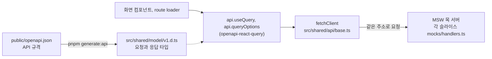

# 개발 가이드

[README](../README.md)로 돌아가기

유지보수 단계라 새 기능은 들어오지 않습니다. 버그를 고치거나 코드를 정리할 때 알아야 할 규칙을 모았습니다.

## 코드 구조

[Feature-Sliced Design(FSD)](https://feature-sliced.design/kr/) 구조를 따릅니다. `src` 아래 레이어는 위에서 아래로만 가져다 씁니다. 예를 들어 features는 entities와 shared를 쓸 수 있지만 pages를 가져다 쓰면 안 됩니다. 같은 레이어의 슬라이스끼리도 서로 가져다 쓰지 않습니다. `pnpm fsd`가 이 규칙을 검사하고, PR에서는 CI가 같은 검사를 돌립니다.

| 레이어     | 들어 있는 것                                                             | 예                                                      |
| ---------- | ------------------------------------------------------------------------ | ------------------------------------------------------- |
| `app`      | 앱 시작, 라우터, 전역 프로바이더, 목 서버 시작, 전역 스타일, 테스트 설정 | `app/providers/router.tsx`, `app/testing/setupTests.ts` |
| `pages`    | 주소 하나에 대응하는 화면과, 그 화면에서만 쓰는 API 호출과 목 데이터     | `pages/production/orders`, `pages/login`                |
| `widgets`  | 여러 화면이 같이 쓰는 큰 덩어리                                          | 모듈 헤더와 탭(`widgets/Layout`), `Header`, `Footer`    |
| `features` | 등록, 수정 같은 사용자 동작. 대부분 폼과 처리 흐름입니다                 | `features/item-process`, `features/branch-select`       |
| `entities` | 품목, 지점, 거래처 같은 업무 데이터의 타입과 조회 API                    | `entities/part`, `entities/branch`, `entities/user`     |
| `shared`   | 업무와 상관없는 공용 코드                                                | UI 컴포넌트, API 클라이언트, 생성된 API 타입            |

코드를 어디에 둘지는 이렇게 정합니다.

- 한 화면에서만 쓰는 폼과 API 호출은 pages에 그대로 둡니다. 미리 나누면 오히려 복잡해지기 때문입니다.
- 같은 코드가 세 곳 이상에서 겹치면 features나 entities로 내립니다. 두 곳에서만 겹칠 때는 서로 가져다 쓰지 말고 각자 둡니다.
- `pages/production/orders`처럼 모듈 폴더 아래에 화면 폴더가 있으면, `production`은 화면을 묶는 폴더일 뿐이고 `orders`가 슬라이스 하나입니다. 같은 모듈의 화면끼리도 서로 가져다 쓰지 않습니다.

슬라이스 폴더 이름은 kebab-case이고, 안쪽은 하는 일에 따라 나눕니다. 밖에서는 `index.ts`가 내보내는 것만 가져다 씁니다.

```
features/item-process/
├── api/      # 요청 함수와 route loader
├── model/    # 타입, 폼 스키마
├── ui/       # 컴포넌트
├── lib/      # 순수 함수 (필요할 때만)
├── mocks/    # 목 데이터(data.ts)와 MSW 핸들러(handlers.ts)
└── index.ts  # 밖으로 내보내는 것
```

새 파일 이름은 같은 자리의 이웃 파일을 따릅니다. 컴포넌트 파일은 `Login.tsx`처럼 대부분 PascalCase이고 `widgets` 아래 폴더도 PascalCase인데, features 안에는 `item-process-form.tsx`처럼 kebab-case 파일도 섞여 있습니다.

## 라우팅

- 모든 경로는 `src/app/providers/router.tsx` 한 파일에 있습니다. 모듈 화면은 lazy로 불러옵니다.
- 지금 모듈 화면은 route loader에서 TanStack Query의 `ensureQueryData`로 처음 그릴 데이터를 먼저 받아 둡니다. 검색어나 선택값에 따라 다시 부르는 데이터는 컴포넌트 안에서 `api.useQuery`로 부릅니다. 어느 쪽으로 할지는 화면에 맞게 정합니다.
- 로그인 확인은 모듈 경로(`/master`, `/sales` 등)에 붙은 `requireAuth` loader가 맡습니다. 사용자 정보가 없으면 `/login`으로 보내므로, 모듈 안에 탭을 더할 때는 따로 넣지 않아도 됩니다.
- 탭을 하나 더하거나 옮길 때는 세 군데를 고칩니다. router의 경로, `src/widgets/Layout/`의 모듈별 Layout 파일 탭 목록, `src/pages/home/ui/Home.tsx`의 홈 카드 메뉴입니다. 홈 카드 메뉴는 Layout 탭과 따로 관리됩니다.
- 탭에 없지만 주소로는 열리는 예전 화면이 있습니다. `/master/departments`, `/master/positions`는 목 핸들러가 있고, `/hrm/payroll`, `/hrm/attendance`, `/hrm/evaluation`은 API를 부르지 않고 화면 코드 안의 데이터를 그립니다.

## API 호출



- API 호출은 `@/shared/api`의 `api`로 씁니다. `api.useQuery`, `api.useMutation`, loader에서 쓸 `api.queryOptions`가 있고, 주소와 요청, 응답 타입은 생성된 타입에서 자동으로 맞춰집니다.
- `fetchClient`는 모든 요청에 공통 헤더를 붙이고 쿠키를 함께 보냅니다. 401이 오면 토큰 재발급을 한 번 시도한 뒤 원래 요청을 다시 보내고, 재발급도 실패하면 `auth:failed` 이벤트를 보내고, `App.tsx`가 이 이벤트를 받아 로그아웃 처리합니다.
- 요청 결과를 알릴 때는 `@/shared/lib`의 `useNotification`이 주는 `showSuccess`, `showError`, `showConfirm`을 씁니다.
- 화면 데이터는 TanStack Query 캐시에 둡니다. Zustand 스토어는 세 개입니다. 로그인한 사용자 정보는 `entities/user`의 `useAuthStore((state) => state.user)`로 읽습니다. 선택한 창고와 공장은 `features/branch-select`가 `agency`, `wms`, `factory` 모듈 종류별로 따로 들고 있고, 브라우저에 저장하지 않아 새로고침하면 처음 값으로 돌아갑니다. 테마는 `shared/lib/theme.store.ts`에 있습니다.

### API 규격

- 기준은 `public/openapi.json`(OpenAPI 3.0)입니다. 원래는 10개 서비스의 Swagger 문서를 합쳐 타입 파일 `src/shared/model/v1.d.ts`를 만들었고, 백엔드가 사라진 뒤 그 타입 파일을 거꾸로 OpenAPI 문서로 되돌린 것이 `openapi.json`입니다. 이 문서로 타입을 다시 만들면 원래 타입 파일과 내용이 같습니다.
- 규격을 바꿀 때는 `openapi.json`에 경로와 스키마를 고치고 `pnpm generate:api`로 타입을 다시 만듭니다. `v1.d.ts`는 생성 파일이라 직접 고치지 않습니다. 그다음 같은 규격으로 목 핸들러를 맞춰 주세요.
- 경로는 그 데이터를 맡는 도메인 서비스 아래(`/api/서비스/...`)에 둡니다. auth는 로그인과 토큰, user는 사용자와 직원 정보, order는 판매 주문과 출고, warehouse는 재고와 ROP와 발주 입고, factory는 공장의 부품 주문과 생산 계획, purchase는 구매 요청, part와 material은 부품과 원자재 기준 정보, site는 창고, 공장, 대리점 같은 지점 정보를 맡습니다. agency는 타입에는 있지만 이 웹에서는 부르지 않습니다.
- `/swagger.html`은 `openapi.json`을 서비스별로 보여 주는 페이지입니다. 백엔드가 없어서 화면에서 요청을 보내 보는 기능은 꺼 두었습니다.

## 목 서버

- 슬라이스마다 `mocks/data.ts`(데이터)와 `mocks/handlers.ts`(MSW 핸들러)를 둡니다. `src/app/providers/mocks/handlers.ts`가 `src` 아래의 `mocks/handlers.ts`를 모두 찾아 등록하므로 따로 목록에 넣을 필요는 없습니다.
- 핸들러가 없는 요청은 경고 없이 목 서버를 지나가서 실패합니다. 화면이 비어 있으면 브라우저 개발자 도구의 Network 탭에서 그 요청이 404로 끝났는지 먼저 확인해 보세요.
- 핸들러는 화면에 보이는 데이터를 돌려주는 것이 기본입니다. 페이지 나누기, 검색, 정렬은 화면이 아니라 핸들러가 쿼리 값을 읽어 처리합니다. 추가나 삭제 같은 쓰기 동작은 필요하면 만들어도 됩니다. 가입 승인, 권한 검사 같은 백엔드의 업무 규칙과 로그인 검사는 넣지 않습니다.
- 응답은 규격의 공통 모양 `{ status, success, code, message, data }`로 감쌉니다. `src/shared/mocks`의 `apiSuccess`, `apiFail`이 이 모양을 만들어 줍니다.
- 실제 서버처럼 보이게 핸들러마다 `sleep`으로 응답 지연을 넣습니다. 새 핸들러에 넣어도 되고, `VITE_PERF_MODE`가 켜진 빌드에서는 `sleep`이 바로 끝납니다.
- 목 데이터는 그 데이터를 부르는 API와 같은 슬라이스에 둡니다. 여러 슬라이스가 같은 데이터를 읽고 고쳐야 한다면 entities에 두고 가져다 씁니다. 품목 데이터가 그 예로, `entities/part`에 두고 기준 정보 품목 화면, 부품 조회, 품목 등록이 같이 씁니다. 두 슬라이스만 겹칠 때는 상황을 보고 정합니다.
- 새 목 데이터의 숫자 ID는 같은 목록의 가장 큰 값에 1을 더해 만듭니다. 날짜는 지금 날짜를 기준으로 쓰고, 코드는 이웃 데이터와 같은 형식을 따릅니다.

| 데이터               | 코드 예                         |
| -------------------- | ------------------------------- |
| 판매 주문, 출고 지시 | `SO-2026-00090`                 |
| 발주                 | `PO-2026-00123`                 |
| 부품 주문, 작업 지시 | `WO-2026-00012`                 |
| 구매 요청            | `PR-2026-00010`                 |
| 부품                 | `ENG-FUEL-001`, `CHS-BRAKE-001` |
| 창고, 공장           | `WH-ICHI`, `FAC-SEOUL`          |
| 거래처(대리점)       | `VEND-AGY-001`                  |

## 공용 UI와 스타일

`src/shared/ui`에 공용 컴포넌트가 있습니다. 카탈로그 화면은 따로 없어서, 무엇을 쓸지는 아래 표를 먼저 보고 사용 예는 이웃 화면에서 찾아 주세요.

| 쓰임                 | 컴포넌트                                                                                                            |
| -------------------- | ------------------------------------------------------------------------------------------------------------------- |
| 페이지를 넘기는 목록 | `table-pagination`의 `PaginationTableSection`. 제목, 페이지 정보, 페이지 이동이 붙어 있어 목록 화면 대부분이 씁니다 |
| 페이지가 없는 표     | `TableSection` 안에 `Table`. `TableSection`은 제목과 오른쪽 버튼 자리가 있는 틀입니다                               |
| 표 자체              | `Table`. `columns`, `data`, `loading`을 받습니다                                                                    |
| 테두리가 있는 묶음   | `Card`                                                                                                              |
| 안내 문구 상자       | `InfoBox`. `info`, `success`, `warning`, `error` 네 가지가 있습니다                                                 |
| 입력과 버튼          | `Input`, `Select`, `Textarea`, `Button`, `SearchFilterBar`, `Modal`, `Badge`, `Spinner`, `Toast`                    |

`Box`와 `StatCard`는 지금 쓰는 화면이 없습니다.

- 스타일은 Tailwind CSS 4를 쓰고, 색상 토큰은 `src/app/styles/theme.css`에 있습니다.
- 다크 모드는 `<html>`에 붙는 `.dark` 클래스로 켜집니다. 토큰이 라이트와 다크로 나뉘어 있어서 `dark:` 클래스를 함께 붙입니다. 예: `bg-bg-card-white dark:bg-bg-card-black`
- 화면 디자인 시안은 [Figma 삼품관리 파일](https://www.figma.com/design/gdGFzH1gB53Nmfad1e9MZM/%EC%82%BC%ED%92%88%EA%B4%80%EB%A6%AC?node-id=0-1)에 있습니다. 읽기만 할 수 있습니다.
- 로컬 개발 서버에서는 오른쪽 아래에 야자수 버튼이 보입니다. 서버 데이터 캐시를 확인하는 TanStack Query Devtools이고, 배포본에는 나오지 않습니다.

## 테스트와 자동 검사

- 테스트는 Vitest, React Testing Library, jsdom을 씁니다. 테스트 파일은 대상 파일 옆에 `*.test.ts(x)`로 두고, 공통 설정은 `src/app/testing/setupTests.ts`에 있습니다.
- 테스트에서도 MSW가 켜집니다. 설정 파일이 모든 슬라이스의 핸들러를 담은 Node용 목 서버(`src/app/providers/mocks/server.js`)를 띄우고, 핸들러가 없는 요청이 나가면 테스트가 실패합니다.
- 지금 테스트 파일은 7개이고 대부분 `shared/ui` 컴포넌트를 다룹니다. 테스트를 꼭 함께 써야 한다는 규칙은 없습니다.
- 커밋할 때는 husky가 `lint-staged`로 스테이징한 파일만 Prettier와 ESLint로 정리합니다. 훅은 `pnpm install`할 때 자동으로 설치됩니다.
- PR을 올리면 GitHub Actions가 build, lint, test, typecheck, fsd 다섯 가지를 돌립니다. 로컬의 `pnpm validate`와 같은 검사입니다.

## 명령

| 명령                                  | 하는 일                                                                                                                    |
| ------------------------------------- | -------------------------------------------------------------------------------------------------------------------------- |
| `pnpm dev`                            | 목 서버를 켠 개발 서버입니다. 목 응답에는 실제 서버처럼 약간의 지연이 들어갑니다                                           |
| `pnpm build` / `pnpm preview`         | 배포용 빌드와 그 결과 미리보기입니다. 목 서버가 켜진 채로 빌드되고, Vercel도 이 빌드를 씁니다                              |
| `pnpm build:perf` 다음 `pnpm preview` | 목 응답 지연을 뺀 빌드입니다. 화면 성능을 볼 때 씁니다                                                                     |
| `pnpm test`                           | 테스트를 한 번 실행합니다. `test:watch`는 파일이 바뀔 때마다, `test:ui`는 브라우저 화면에서 실행합니다                     |
| `pnpm lint` / `pnpm lint:fix`         | ESLint 검사와 자동 수정                                                                                                    |
| `pnpm typecheck`                      | TypeScript 타입 검사                                                                                                       |
| `pnpm fsd`                            | steiger로 FSD 레이어 규칙 검사                                                                                             |
| `pnpm validate`                       | test, lint, typecheck, build, fsd를 한꺼번에 실행합니다                                                                    |
| `pnpm generate:api`                   | `public/openapi.json`으로 `src/shared/model/v1.d.ts`를 다시 만듭니다                                                       |
| `pnpm clean`                          | `node_modules`, `pnpm-lock.yaml`, `dist`를 지웁니다. 다시 설치해서 `pnpm-lock.yaml`이 바뀌어도 그 변경은 커밋하지 않습니다 |

`pnpm prettier`도 있지만 돌리지 않아도 됩니다. 커밋할 때 바뀐 파일만 자동으로 정리됩니다.

## 환경 변수

설정 값은 저장소에 커밋된 `.env` 한 파일에 있고, 로컬의 모든 명령과 Vercel 빌드가 이 파일을 같이 읽습니다.

| 변수             | 하는 일                                                   | 값                                        |
| ---------------- | --------------------------------------------------------- | ----------------------------------------- |
| `VITE_USE_MOCK`  | `true`면 MSW 목 서버를 켭니다                             | `.env`에서 `true`                         |
| `VITE_BASE_URL`  | API 주소 앞부분입니다. 비우면 지금 열린 주소로 요청합니다 | `.env`에서 빈 값                          |
| `VITE_PERF_MODE` | `true`면 목 응답의 인위적 지연을 없앱니다                 | `.env.perf`에서 `true`, `build:perf` 전용 |

- 서버가 없어서 `VITE_USE_MOCK=false`로 실제 백엔드에 붙는 경우는 더 관리하지 않습니다.
- 목 서버는 지금 열린 주소로 가는 요청만 받습니다. `VITE_BASE_URL`에 다른 도메인을 넣으면 요청이 목 서버를 지나쳐 그 주소로 나가고, 로그인부터 실패합니다. 3000번 포트가 차서 3001번 같은 다른 포트로 떠도 그대로 쓸 수 있는 것도 이 때문입니다.
- 내 PC에서만 값을 바꾸려면 `.env.local`을 만들어 씁니다. `.env`보다 우선하고, 커밋되지 않습니다.
- 새 환경 변수는 `VITE_` 접두사를 붙여 `.env`에 넣고, 코드에서는 `import.meta.env.VITE_이름`으로 읽습니다. `VITE_` 값은 빌드 결과에 그대로 드러나므로 비밀 값은 넣지 않습니다.
- Vercel 대시보드에는 환경 변수를 넣지 않습니다. 대시보드에 같은 이름의 값이 있으면 `.env`보다 우선해서, 저장소 파일을 고쳐도 배포본에 반영되지 않습니다.

## 배포

- Vercel 프로젝트 `chooslas-projects/sampoom-management-frontend`가 이 저장소에 연결돼 있습니다. choosla 개인 팀 계정 아래에 있어서 대시보드는 choosla만 볼 수 있습니다.
- `main`에 머지되면 Production으로 자동 배포됩니다. 주소는 https://sampoom.vercel.app 이고, https://sampoom-management-frontend.vercel.app 도 같은 배포를 가리킵니다.
- PR 미리보기도 `.env`를 읽어 목 서버가 켜지므로 같은 계정으로 로그인할 수 있습니다.
- Vite 환경 변수는 빌드할 때 코드에 들어갑니다. `.env`를 바꾸면 머지 뒤 자동 배포에서 반영됩니다.
- 예전 주소인 samsam.autos는 도메인이 만료되어 더 이상 쓰지 않습니다.

## 기술 스택

| 분류            | 사용                                                                     |
| --------------- | ------------------------------------------------------------------------ |
| 기본            | React 19, TypeScript 5.9, Vite 8                                         |
| 라우팅          | React Router 7 (route loader 사용)                                       |
| 서버 상태와 API | TanStack Query 5, openapi-fetch, openapi-react-query, openapi-typescript |
| 클라이언트 상태 | Zustand 5                                                                |
| 폼              | react-hook-form, zod                                                     |
| 스타일          | Tailwind CSS 4, class-variance-authority, tailwind-merge, Remix Icon     |
| 목 서버         | MSW 2                                                                    |
| 테스트          | Vitest 3, React Testing Library, jsdom                                   |
| 코드 품질       | ESLint 10, Prettier, husky, lint-staged, steiger(FSD 검사)               |
| 배포와 측정     | Vercel, Vercel Analytics, Speed Insights                                 |

정확한 버전은 `package.json`에서 확인할 수 있습니다.
